# FortiGate Segmentation Lab with Wazuh Detection

A three-zone small-office network behind a FortiGate NGFW. It uses least-privilege policies, a hardened admin plane, a verified allow/deny test matrix, and FortiGate logs streamed to Wazuh. A custom detection rule closes a gap in the vendor ruleset: DMZ-to-LAN lateral movement attempts were being silently dropped.

**Stack:** FortiGate-VM (FortiOS 8.0.1, permanent trial) · Wazuh 4.x · Kali Linux · Ubuntu Server 24.04 (nginx) · VMware Fusion (Intel Mac)

## Results

| | |
|---|---|
| Policy tests passed | **9 / 9** (allowed traffic works, everything else hits the implicit deny) |
| DMZ → LAN reachability | **0 ports open**; every attempt denied and logged |
| Admin plane | Reachable from **one host only**; blocked from the rest of the LAN |
| Log pipeline | FortiGate syslog → Wazuh, decoded by the built-in `fortigate-firewall-v5` decoder |
| Detection gap closed | DMZ → LAN denies raised from **level 1 (invisible) to level 10**, mapped to MITRE ATT&CK **T1021** |

## Architecture

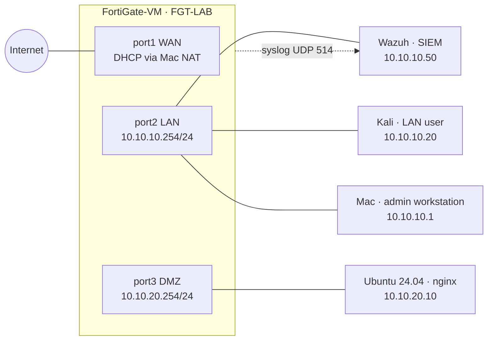

## Firewall policies

The permanent trial caps the VM at 3 interfaces, 3 policies and 3 routes. The design uses exactly three rules. Everything else falls to the implicit deny, which is logged.

| # | Name | From → To | Services | Security profiles | Business reason |
|---|---|---|---|---|---|
| 1 | LAN-to-Internet | LAN → WAN | DNS, HTTP, HTTPS, NTP, PING | Cert inspection, AV, web filter, app control | Staff browsing with visibility and a URL blocklist |
| 2 | LAN-to-DMZ-web | LAN → DMZ web server | HTTP, HTTPS | Cert inspection, AV, IPS (`protect_http_server`) | Staff reach the company site on 80/443 only, with IPS in front of it |
| 3 | DMZ-to-Internet-updates | DMZ web server → WAN | DNS, HTTP, HTTPS, NTP | none | Package updates only |
| 0 | Implicit deny | anything else | all | logged | DMZ → LAN, SSH into the DMZ, and all other traffic |

## Hardening

| Control | Setting |
|---|---|
| Admin access | Only `10.10.10.1/32` (trusted host). Verified: Kali on the same subnet times out |
| Admin port | HTTPS moved from 443 to 8443. WAN interface allows ping only |
| Sessions | 10 min idle timeout. Lockout for 5 min after 3 failed logins |
| Passwords | 12+ characters, mixed case, number, symbol |
| Crypto | `strong-crypto` enabled |
| Login banner | Pre-login disclaimer enabled |
| Time | NTP sync, so logs line up with the SIEM |
| Logging | Implicit-deny logging on. Admin (local-in) allow and deny logging on |

## Test matrix

| # | Source | Test | Expected | Result |
|---|---|---|---|---|
| T1 | Kali (LAN) | `ping 1.1.1.1` | Allowed (policy 1) | Pass |
| T2 | Kali | `curl -I https://www.google.com` | `HTTP/2 200` | Pass (after the web filter fix below) |
| T3 | Kali | `curl http://10.10.20.10` | Company page (policy 2) | Pass |
| T4 | Kali | `ping 10.10.20.10` | Blocked | Pass |
| T5 | Kali | `nc -zv 10.10.20.10 22` | Blocked | Pass |
| T6 | Kali | `curl http://www.facebook.com` | `403`, local URL filter | Pass |
| T7 | Web server (DMZ) | `apt update` | Allowed (policy 3) | Pass |
| T8 | Web server | `ping 10.10.10.20` | Blocked | Pass |
| T9 | Web server | `nmap -Pn -p 22,80,443 10.10.10.20` | All filtered | Pass |

Every denied test appears in Forward Traffic logs against **Policy ID 0 (Implicit Deny)**.

## Findings

### 1. Web filter failed closed without FortiGuard

After policy 1 was applied, all HTTPS browsing from the LAN failed. `curl -v` showed a certificate issued by the FortiGate's own CA. That is the replacement block page, not Google. `example.com`, which is not on the blocklist, returned `403 Forbidden`.

**Cause:** The trial VM has no FortiGuard subscription, so every category rating lookup errors. The web filter's default behaviour on a rating error is to block.

**Fix:** `set options error-allow` under `config ftgd-wf` in the profile. Unrated sites pass, and the local URL blocklist still applies. The web filter log shows both states: Google and example.com blocked before 23:47, passthrough after, with facebook.com and neverssl.com still blocked by `Local URLfilter Block`.

Side note: FortiGate does not return the block page to `HEAD` requests (`curl -I`), so URL filter tests should use `GET`.

### 2. SIEM blind spot for DMZ-to-LAN attempts

FortiGate logs reached Wazuh and decoded correctly. Web filter blocks alerted at level 6 (rule 81644). The DMZ server's attempts to reach the LAN produced **no alert at all**.

**Cause:** With archives enabled, the raw logs showed these denies matching vendor rule **81618, "Fortigate: Traffic to be aware of", at level 1**. That is below Wazuh's default alert threshold of 3, so they are stored but never shown to an analyst. A compromised public-facing server probing inward is exactly the event a SOC needs to see.

**Fix:** Custom rule `100200` ([`wazuh/local_rules.xml`](wazuh/local_rules.xml)), a child of 81618. It matches `srcintfrole=dmz`, `dstintfrole=lan` and `action=deny`, raises the event to **level 10**, and maps it to MITRE ATT&CK **T1021 (Lateral Movement: Remote Services)**. Tested with pings from the DMZ: every blocked packet produced a level-10 alert.

A smaller detail: vendor rule 81644 describes local URL blocklist hits as "denied category". The raw log (`urlsource="Local URLfilter Block"`) shows the real reason.

## Screenshots

**Build**

| | |
|---|---|
| Fusion lab network (vmnet2 LAN, no DHCP or NAT) | 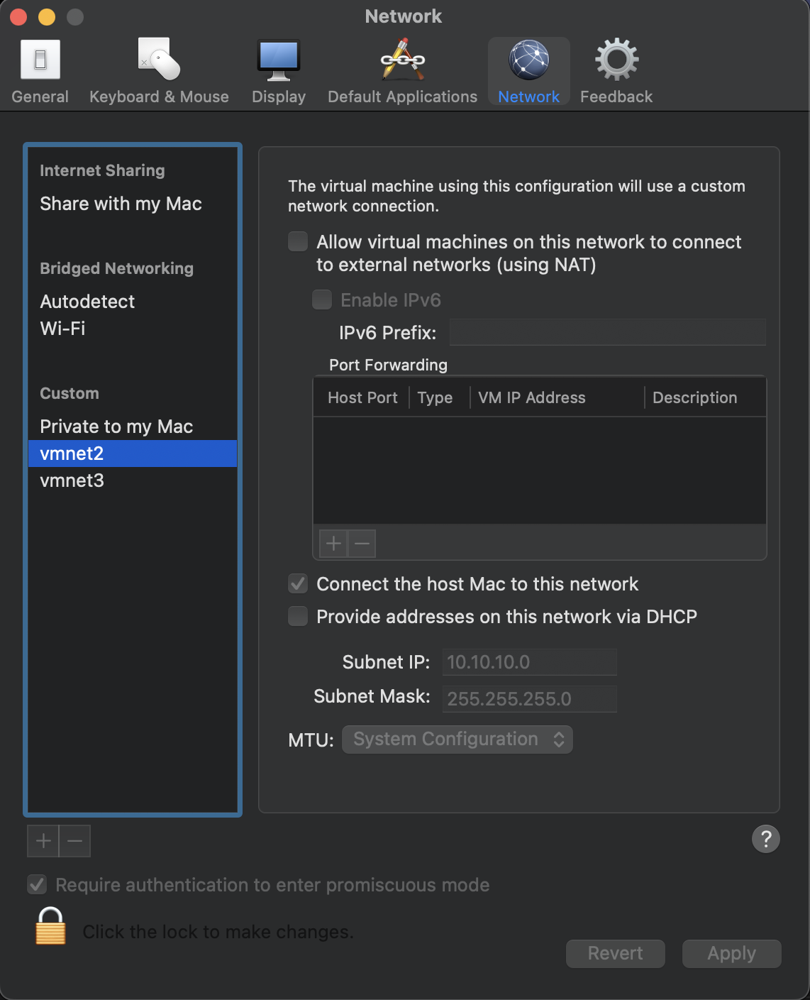 |
| Trial licensed: 1 vCPU / 2 GB | 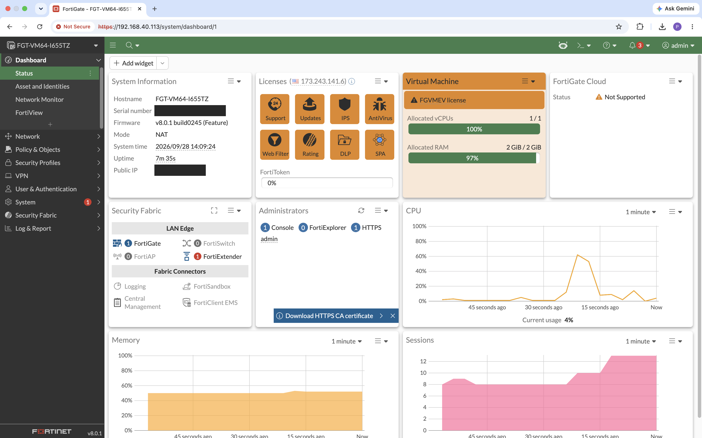 |
| Interfaces and roles | 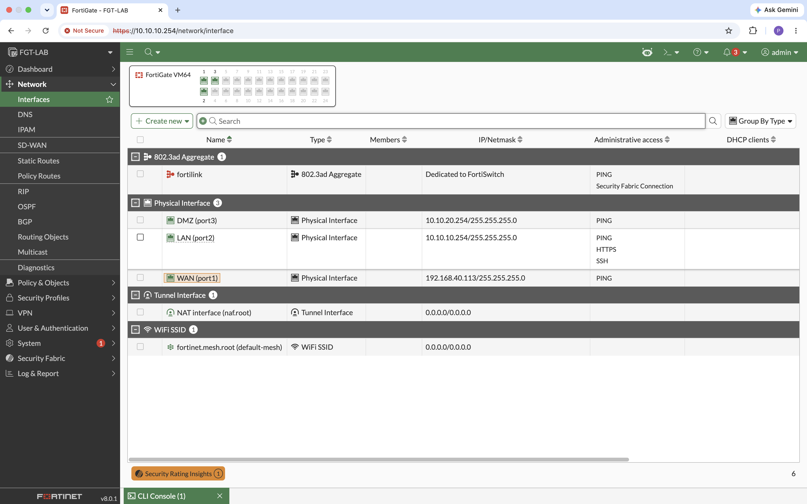 |
| Default deny before any policy (Kali reaches the gateway, not the internet) | 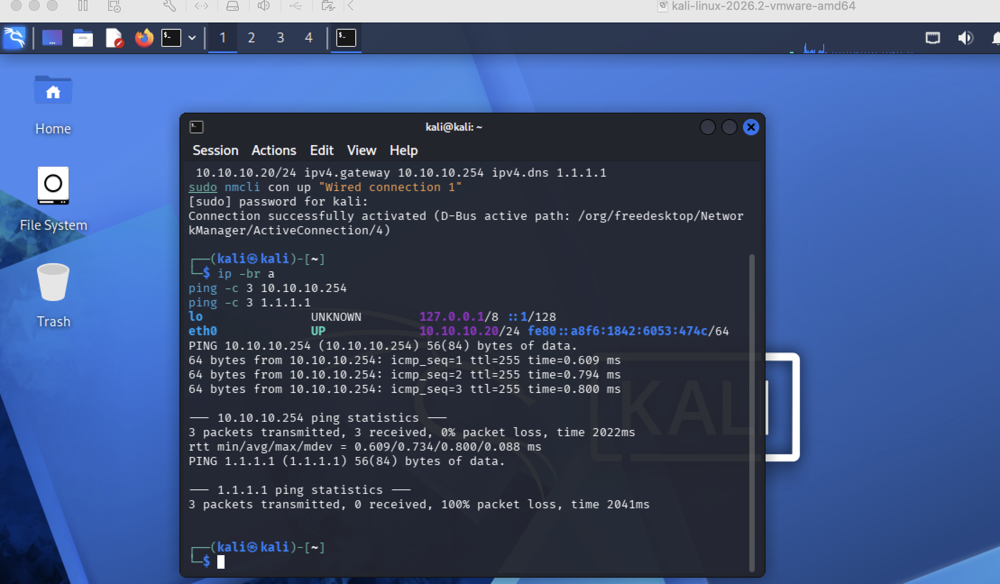 |
| DMZ server isolated from the LAN | 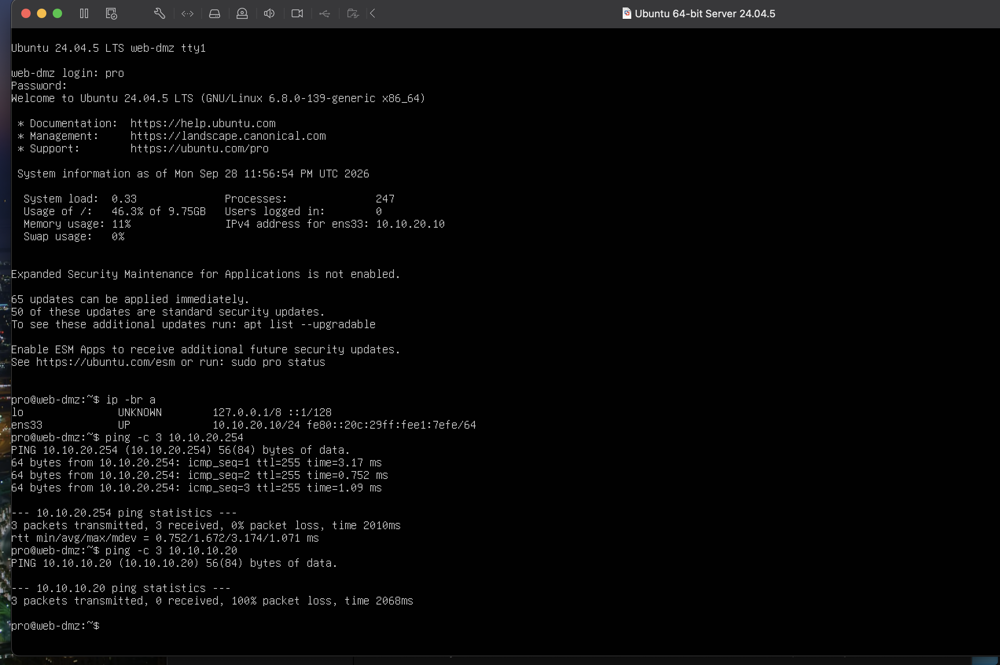 |
| Wazuh second NIC on the LAN | 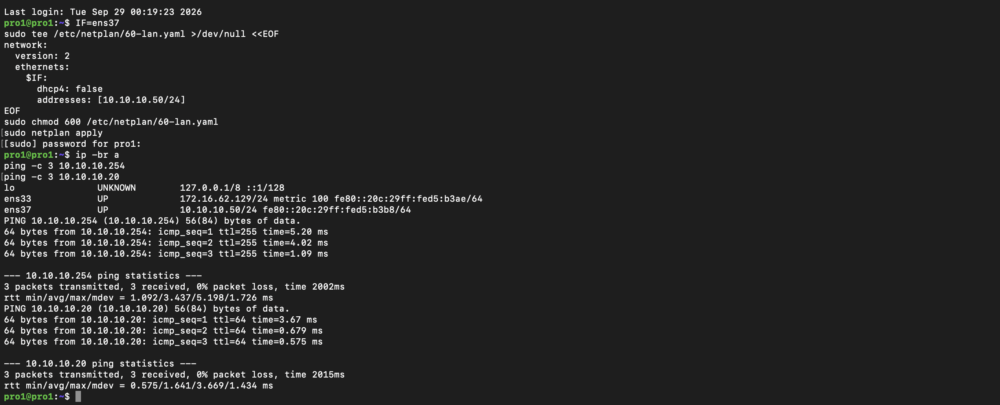 |

**Hardening**

| | |
|---|---|
| Admin on 8443, 10 min idle timeout | 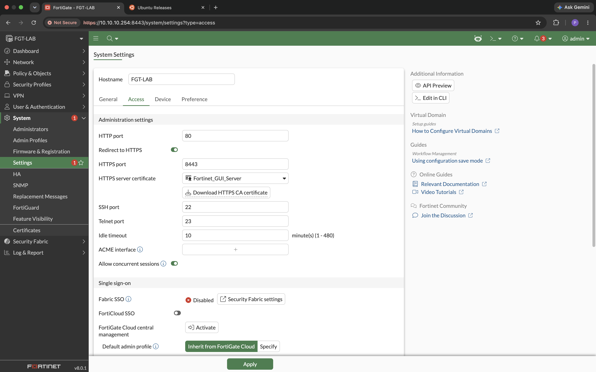 |
| Trusted host: one admin workstation | 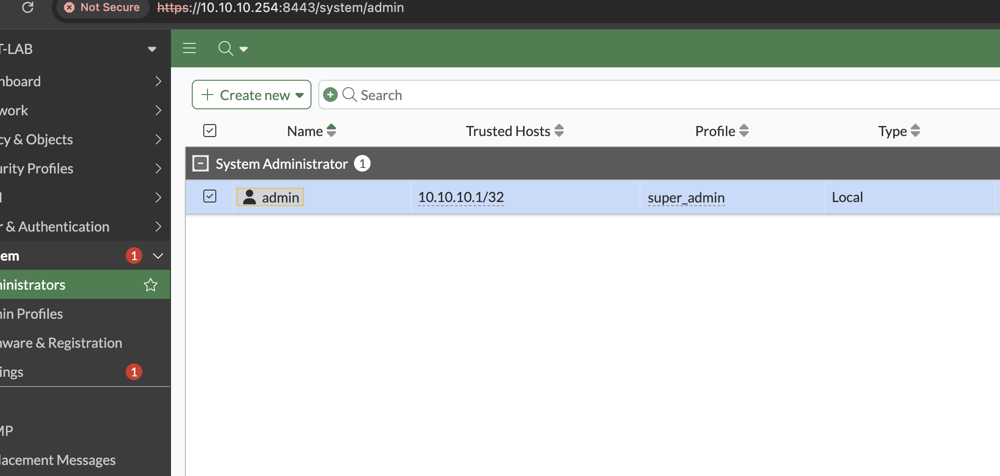 |
| Admin page unreachable from Kali on the same subnet | 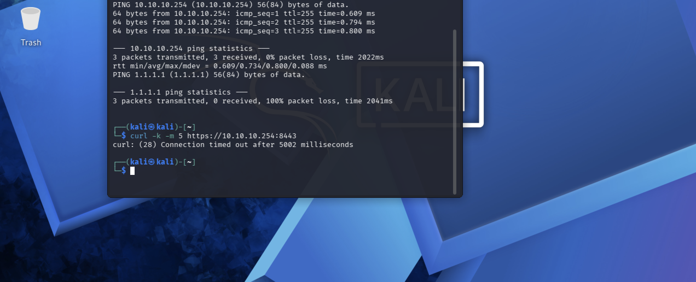 |

**Policies and verification**

| | |
|---|---|
| The three firewall policies | 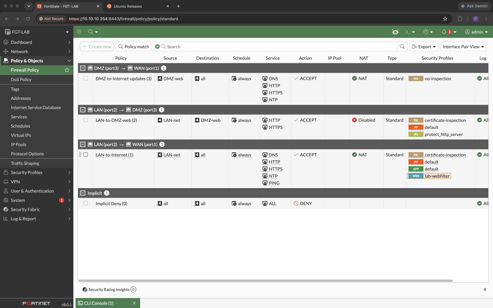 |
| Web filter profile: FortiGuard not licensed on the trial | 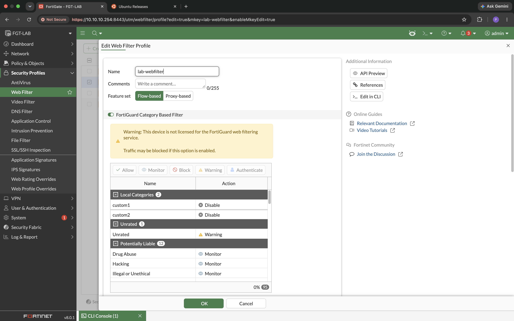 |
| LAN tests T1 to T6 | 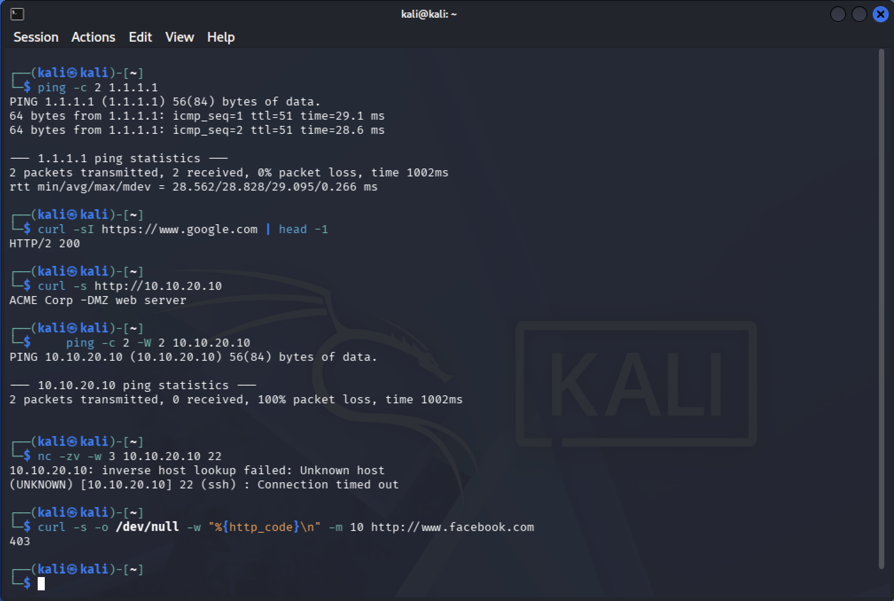 |
| DMZ tests T7 to T9 | 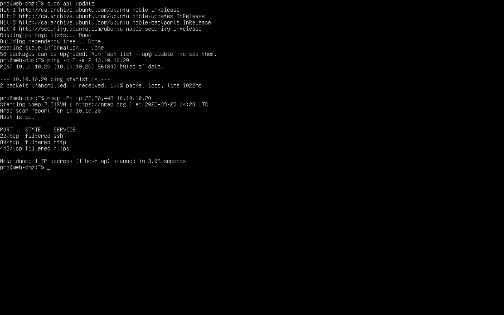 |
| Implicit deny log, DMZ to LAN | 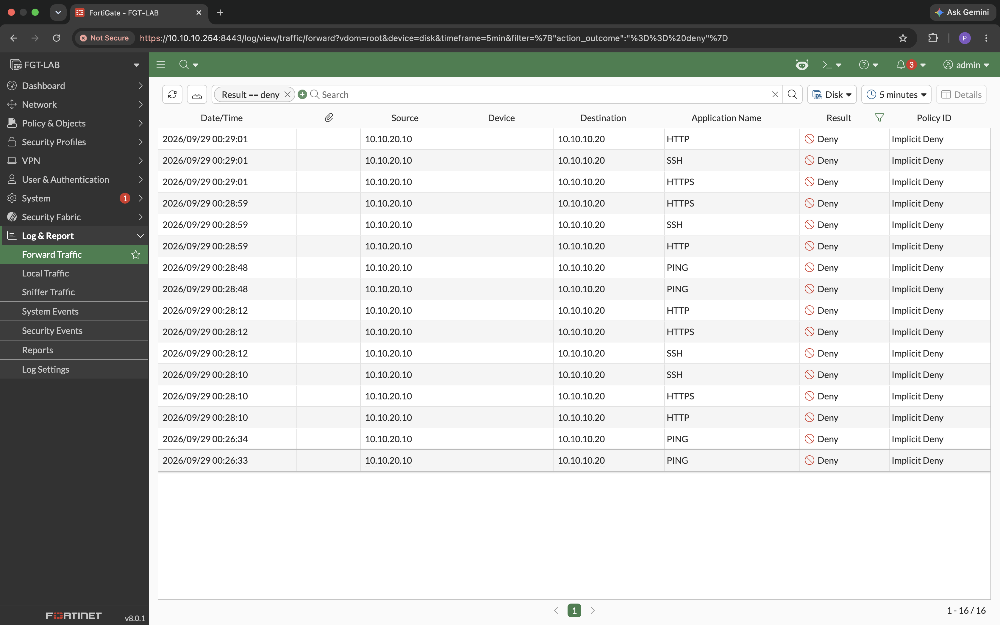 |
| Web filter log before and after the fail-closed fix | 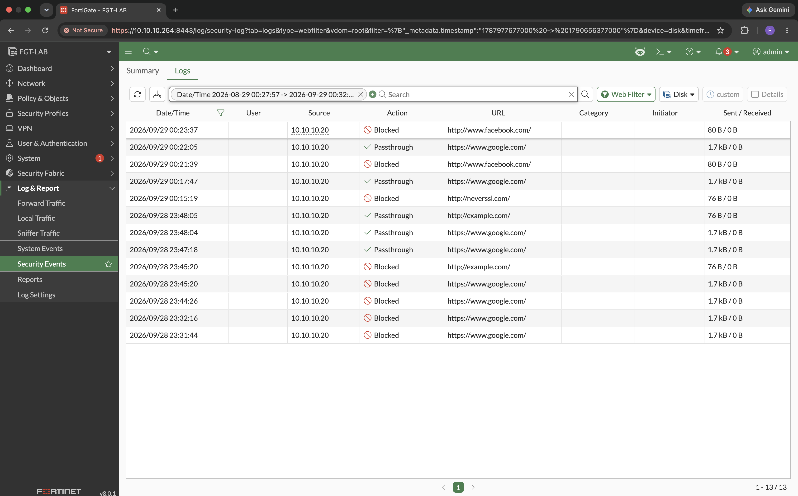 |

**SIEM**

| | |
|---|---|
| Syslog arriving at Wazuh | 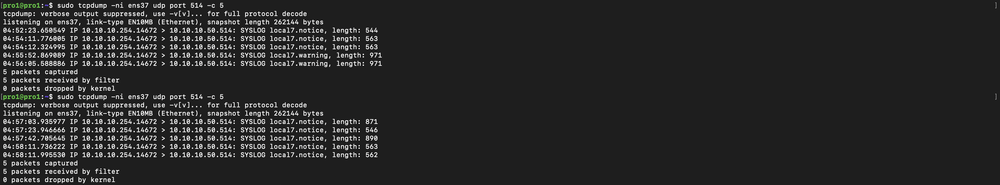 |
| FortiGate alerts in Wazuh | 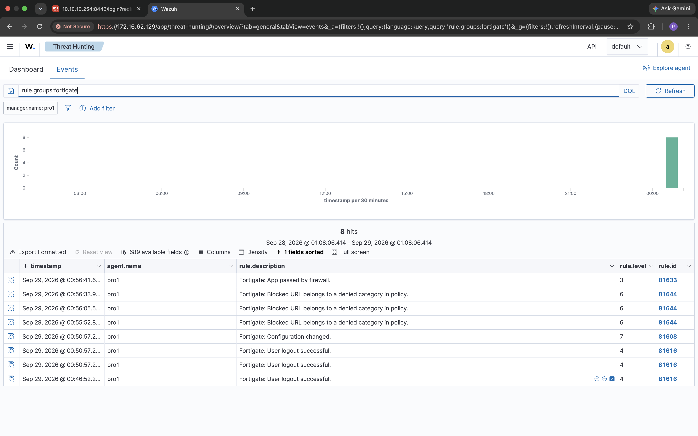 |
| Custom rule 100200: DMZ to LAN lateral movement, level 10 | 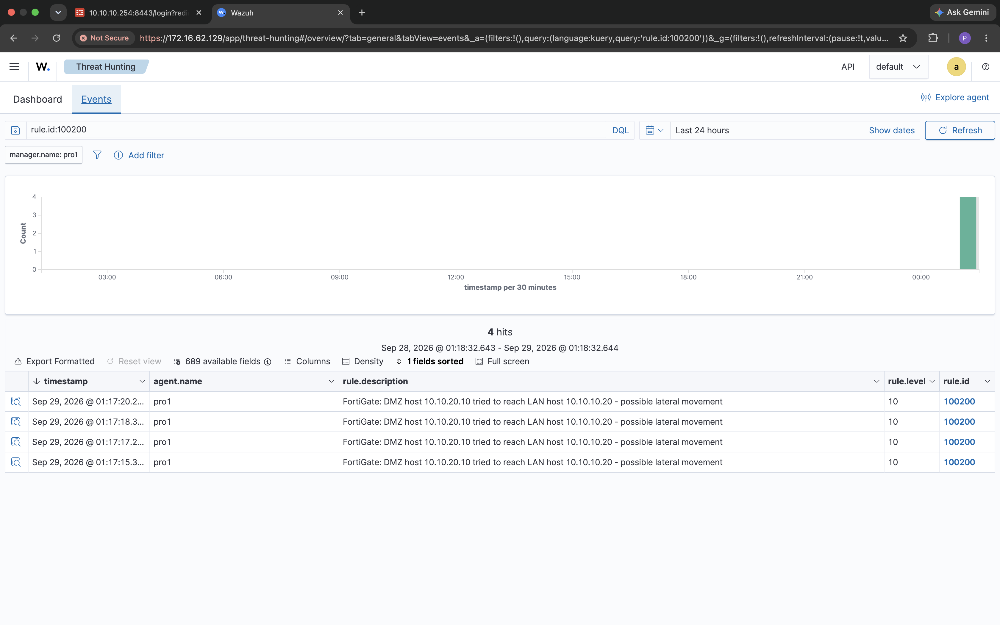 |

## Rebuild it

1. **VMware Fusion networks:** `vmnet2` 10.10.10.0/24 (host connected), `vmnet3` 10.10.20.0/24 (host not connected). DHCP and NAT off on both.
2. **FortiGate-VM:** import `FGT_VM64` for VMware ESXi. Use 1 vCPU, 2 GB RAM and 3 NICs (NAT, vmnet2, vmnet3). Activate the permanent evaluation licence with a FortiCare account.
3. **Configuration:** apply [`configs/fortigate-lab-snippets.conf`](configs/fortigate-lab-snippets.conf). Set the trusted host to your own admin IP first.
4. **Endpoints:**
   - Kali on vmnet2, `10.10.10.20`.
   - Ubuntu Server 24.04 on vmnet3, `10.10.20.10`, running nginx.
   - Wazuh gets a second NIC on vmnet2, `10.10.10.50`, with no gateway on that NIC.
5. **Wazuh:**
   - Append [`wazuh/ossec-syslog.xml`](wazuh/ossec-syslog.xml) to `ossec.conf`.
   - Append [`wazuh/local_rules.xml`](wazuh/local_rules.xml) to `/var/ossec/etc/rules/local_rules.xml`.
   - Restart `wazuh-manager`.
6. **Verify:** run the test matrix, then search `rule.groups:fortigate` and `rule.id:100200` in Wazuh.

## Limitations

- **Trial limits:** 3 policies, 3 interfaces, low encryption and no FortiGuard. There is no category web filtering, no signature updates for AV and IPS, and no admin-only SSH rule to the DMZ. Production would add a jump-host rule such as "SSH from admin workstation to DMZ".
- **Syslog is UDP and unencrypted.** Production would use TCP/TLS syslog (reliable mode) or FortiAnalyzer.
- **Attack testing is limited to reachability and URL policy.** IPS was enabled but not exercised with exploit traffic.
- **Single admin account.** Production would use named admin accounts, MFA through FortiToken or SAML, and a separate read-only role.

---
Built by **Prosper Emerole** · [github.com/Emerole7](https://github.com/Emerole7)
